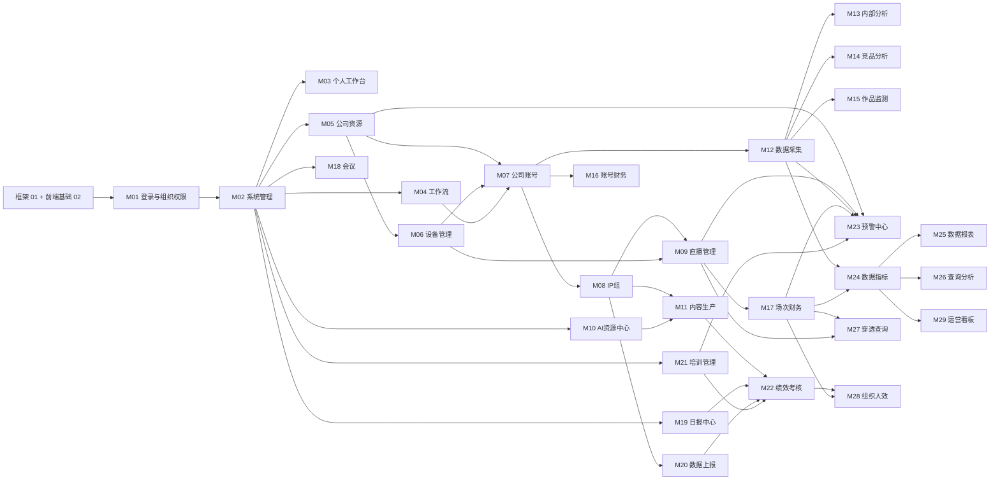

# IMS 重写 · 03 模块清单与依赖顺序

> 版本：v1.1 · 2026-10-12 · 编写：IMS 产品经理
> v1.3 变更（2026-10-12）：培训 AI 配置落点改到 **B10 / M10**「模型连接 / 提示词」（不再放 B2 系统参数）；B0a 只留骨架+mock；B21 联调在 B10 配置页填密钥。M21 编码期仍可用 mock，不阻塞于 B10 页面，但真实配置读取走 B10。
> v1.2（定稿）变更：D-07 日报应提交天数按独立钉钉考勤应用（开发期模拟）；D-08 直播表测试用替身表；培训 AI 试卷改为独立模型连接；A-22 本地部门规则已决策；无待决策项。
> v1.1 变更：按 zhang wu 决策 D-01～D-06 与新增「部门组织管理」需求更新——M02 用户管理补左侧部门树与本地部门维护、个人中心；M07 增「个人账号」独立菜单（D-04）；M09 写明 Football 直播表只读连接边界（D-01）；M22 只保留「方案→执行→结果」（D-03）；M25～M27 补回 SQL 动态查询、多层钻取、两个性能监控页、数据大屏（D-05）；批次与进入条件同步更新。
> 本步只拆到「模块 — 页面」级，不拆功能点。
> 依据：【PRD】`产品PRD/IMS完整产品需求文档.md` §3A 功能点清单、§6 关键业务流程；各模块 `产品规格/V1~V3/*-页面规格.md` 的「模块总览 / 页面」表；原型 `UI原型/pages/*.html`（侧栏结构取自 `workbench.html`，非侧栏页取自 `index.html`「未进侧栏」清单）；【裁定】2026-10-11/12 产品裁定。
> 冲突处理：PRD 与原型冲突时，以 PRD 业务实现为准；原型缺页按规格补页（见各模块「规格有、原型缺页」）。

---

## 1. 汇总

| 项 | 数量 | 说明 |
|----|------|------|
| 业务模块 | **29**（M01～M29） | 按侧栏 L2 分组划分；“数据决策”拆为 6 个模块（数据指标 / 数据报表 / 查询分析 / 穿透 / 人效 / 运营看板），“协同与成长”拆为 6 个 |
| 原型目录文件 | 126 | 125 个 `.html` + 1 个 `shared.css`（`shared.css` 归入 02 前端基础层） |
| 已分配页面 | **125 / 125**（100%） | 脚本校验无遗漏、无重复分配（`_work/modmap.py`） |
| 其中：主页面（需开发） | 88 | v1.1：`bi0Screen` 由占位页改为主页面（D-05 数据大屏要做，原型仅占位，需补全） |
| 本期不做（原型有、ADR-006 列为 Non-Goal） | 2 | `airKey`、`airLog`（见 04 清单 A-16） |
| 重复 / 别名页（与主页面同内容，不单独开发） | 17 | 如 `sys`=`sysUser`、`air`=`airSkill`、`effBoard`=`eff`、`alertHistory`/`alertDedup`=`alertLive` 的 Tab 快照 |
| 旧 IA 页面（走查 #8 已废止的顶级菜单，仅作字段参考） | 4 | `master`、`cert`、`asset`、`acct` |
| 占位页（L2 分组空壳，不开发） | 13 | `*Mgmt`、`*Center`、`content`、`reportOps` 等 |
| 非业务页 | 1 | `index.html`（原型索引） |
| **未分配页面** | **0** | — |
| 规格有、原型缺页 | 34 处（按页逐个计数） | 见第 2 节各模块「规格有、原型缺页」；缺页须在对应模块批次中按规格补原型或直接按规格开发。v1.1 改为按页逐个计数（v1.0 的 25 处把同一行内的多页合并计数，口径不准）；本版另扣除 D-03 取消的绩效 4 页，新增 D-04 个人账号、D-05 数据大屏补全、SYS 个人中心 |
| 原型有页但功能缺失 | 1 处 | `sysUser` 缺左侧部门树与部门维护（v1.1 新需求，见 M02） |

> 关于“126 页”：上级任务描述为 126 个页面，实际目录为 125 个 html + `shared.css`。若另有 1 个页面不在 `pages/` 目录，请指出位置。

---

## 2. 模块与页面清单

### M01 登录与组织权限（AUTH）

- **规格依据**：【AUTH 页面规格】P1 SSO 登录、P2 组织同步、P3 岗位-角色供给规则；【PRD】§3A 01 AUTH-001～003；【ADR-008/009】

| 原型页面（pages/） | 页面标题（原型抽取） | 归类 |
|---|---|---|
| `login.html` | 登录 | 主页面 |
| `authOrg.html` | 组织架构同步（Tab：人员列表/同步事件/对账报告） | 主页面 |
| `authPosition.html` | 岗位-角色供给规则 | 主页面 |
| `auth.html` | 组织架构同步（Tab：人员列表/同步事件/对账报告） | 重复/别名页（同 `authOrg.html`，不单独开发） |
| `authMgmt.html` | 权限管理 | 占位页（L2 分组空壳，不开发） |

### M02 系统管理（SYS）

- **规格依据**：【SYS 页面规格】P1 用户、P2 角色、P3 菜单、P4 字典、P5 参数、P6 日志、P7 通知、P8 租户套餐（P6/P7 规格只有页面表行，无字段级章节）；【PRD】§3A SYS-001～008

| 原型页面（pages/） | 页面标题（原型抽取） | 归类 |
|---|---|---|
| `sysUser.html` | 用户管理 | 主页面 |
| `sysRole.html` | 角色权限 | 主页面 |
| `sysMenu.html` | 菜单管理 | 主页面 |
| `sysDict.html` | 字典管理 | 主页面 |
| `sysParam.html` | 系统参数 | 主页面 |
| `sysLog.html` | 操作/登录日志（Tab：操作日志/登录日志） | 主页面 |
| `sysNotify.html` | 消息通知 | 主页面 |
| `sysTenant.html` | 租户套餐 | 主页面 |
| `sys.html` | 用户管理 | 重复/别名页（同 `sysUser.html`，不单独开发） |
| `sysMgmt.html` | 系统管理 | 占位页（L2 分组空壳，不开发） |

- **v1.1 新增需求：部门组织管理（zhang wu）**：`sysUser` 改为「左树右表」（02 清单 UI-L03 + UI-C42）——左侧部门树（搜索、人数、来源标识、新增下级 / 改名 / 移动 / 停用 / 删除、「同步钉钉组织」），右侧为所选部门（可含下级）的人员列表，两边联动；部门数据与同步见 01 清单 FW-B08、FW-D07。冲突规则：钉钉为准（已定，04 清单 A-21）；本地新建部门处理见 04 清单 A-22。**原型缺左侧部门树**（`sysUser.html` 只有提示文字），按 02 模板开发。部门维护不单设菜单，作为用户管理页的一部分（如需独立菜单再议）。
- **规格有、原型缺页**：个人中心（修改本人密码 / 资料、查看本人会话；ADR-009 本地账号必需，规格与原型均无，见 04 清单 C-19，顶栏头像下拉进入）
- **页面完整性复审（v1.1）**：用户生命周期操作（A-23）、岗位来源（A-24）、角色停用删除（A-25）、审核级别参数存角色（A-26）、用户列表字段与状态（B-25）、多部门（B-26）、字典字段（B-27）、角色来源文案（B-28）、租户套餐范围文字（B-29）、菜单（C-15）、参数（C-16）、日志（C-17）、通知（C-18）、套餐维护（C-20）、与组织同步页分工（C-21），均见 04 清单

### M03 个人工作台（AUTH-004 / HOME P2）

- **规格依据**：【AUTH 页面规格】P4 个人工作台；【HOME 页面规格】P2 待办源

| 原型页面（pages/） | 页面标题（原型抽取） | 归类 |
|---|---|---|
| `workbench.html` | 工作台首页（Tab：全部/审批/归还/审核/确认/预警/告警） | 主页面 |
| `workbenchTodos.html` | 待办中心（Tab：全部/审批/归还/审核/确认/预警/告警） | 主页面 |
| `workbenchMsgs.html` | 消息中心（Tab：全部/未读/已读） | 主页面 |

### M04 工作流（FLOW）

- **规格依据**：【FLOW 页面规格】P1 模板、P2 我的流程、P3 看板、P4 版本（二级页）、P5 超时督办统计；【PRD】§3A 14 FLOW-001～004

| 原型页面（pages/） | 页面标题（原型抽取） | 归类 |
|---|---|---|
| `flow.html` | 流程管理（Tab：全部/请假/领用/报销/开播审批/内容审核/看板视图/模板管理） | 主页面 |

- **规格有、原型缺页**：FLOW P4 版本管理（二级页，原型仅「模板管理」Tab）；FLOW P5 超时督办与统计（原型无）

### M05 公司资源（公司 / 实名人 / 手机卡 / 证件）

- **规格依据**：【CORP 页面规格】资源管理 P-R1～R4；【MASTER 页面规格】；【CERT 页面规格】P1 档案、P2 到期预警中心、P3 分级与审计；【PRD】走查 #8 Q4

| 原型页面（pages/） | 页面标题（原型抽取） | 归类 |
|---|---|---|
| `crCompany.html` | 公司管理 | 主页面 |
| `crRealname.html` | 实名人管理 | 主页面 |
| `crSim.html` | 手机卡管理 | 主页面 |
| `crCert.html` | 证件管理 | 主页面 |
| `corpRes.html` | 公司管理 | 重复/别名页（同 `crCompany.html`，不单独开发） |
| `master.html` | 主数据台账（Tab：公司/实名人/手机/手机卡/平台账号/个人账号） | 旧 IA 页面（走查 #8 已废止顶级菜单，仅作字段参考） |
| `cert.html` | 证件档案 | 旧 IA 页面（走查 #8 已废止顶级菜单，仅作字段参考） |

- **规格有、原型缺页**：CERT P2 到期预警中心（原型无独立页）；CERT P3 分级与审计（原型无）

### M06 设备管理（办公 / 直播 / 手机）

- **规格依据**：【CORP 页面规格】设备管理 P-D1～D3；【ASSET 页面规格】P1 台账、P3 反向穿透、P4 关联校验中心；【PRD】走查 #8 Q2

| 原型页面（pages/） | 页面标题（原型抽取） | 归类 |
|---|---|---|
| `cdOffice.html` | 办公设备管理 | 主页面 |
| `cdLive.html` | 直播设备管理 | 主页面 |
| `cdPhone.html` | 手机设备管理 | 主页面 |
| `corpDev.html` | 手机设备管理 | 重复/别名页（同 `cdPhone.html`，不单独开发） |
| `asset.html` | 资产台账 | 旧 IA 页面（走查 #8 已废止顶级菜单，仅作字段参考） |

- **规格有、原型缺页**：ASSET P3 反向穿透（ASSET-002 P0）、P4 关联校验中心（ASSET-003 P1）（走查 #8 新 IA 未给入口，见 04 清单 A-09）

### M07 公司账号管理（5 平台 + 领用/流转/归还/冲话费）

- **规格依据**：【CORP 页面规格】账号管理 P-A1～A5；【ACCT 页面规格】P1 台账、P2 领用、P3 流转收回、P4 离职归还、P5 冲话费；【ACCT-平台账号采集Tab-OPS对齐】；【PRD】走查 #8 Q1/Q3/Q5

| 原型页面（pages/） | 页面标题（原型抽取） | 归类 |
|---|---|---|
| `caWechatOfficial.html` | 公众号 | 主页面 |
| `caWechatChannels.html` | 视频号 | 主页面 |
| `caDouyin.html` | 抖音 | 主页面 |
| `caKuaishou.html` | 快手 | 主页面 |
| `caXhs.html` | 小红书 | 主页面 |
| `corpAcct.html` | 抖音 | 重复/别名页（同 `caDouyin.html`，不单独开发） |
| `acct.html` | 账号台账 | 旧 IA 页面（走查 #8 已废止顶级菜单，仅作字段参考） |

- **规格有、原型缺页**：ACCT P2 领用、P3 流转收回、P4 离职归还、P5 冲话费（PRD 走查 #8 Q3：无独立菜单，经账号/资产详情双向跳转的隐藏路由；原型只有抽屉）；**个人账号**（✅ D-04：5 个平台之外增设第 6 个 L3 独立菜单「个人账号」（企微/个微），不再走 MASTER-006 隐藏路由；原型无独立页，字段参考旧 IA `master.html`「个人账号」Tab；服务号、B 站、斗鱼等其余平台本期不做，平台字典不预置）

### M08 IP 组（IPG）

- **规格依据**：【IPG 页面规格】P1 IP 组管理、P2 作者管理、P3 账号分析、P4 粉丝/作品/内部内容分析；【PRD】§3A 19a IPG-001～005

| 原型页面（pages/） | 页面标题（原型抽取） | 归类 |
|---|---|---|
| `ipg.html` | IP 组运营（Tab：基本信息/成员管理/账号绑定/关联作者/统计） | 主页面 |

- **规格有、原型缺页**：IPG P2 作者管理（IPG-004 要求独立列表；原型只有组内「关联作者」Tab）；IPG P3/P4 账号/粉丝/作品/内部内容分析（IPG-005，含补录；原型无，与内部分析可能重叠，见 04 清单 A-10）

### M09 直播管理（LIVE）

- **规格依据**：【LIVE 页面规格】P0 场次列表、P0-D 场次详情、P1 开播风控（重定向 P0）、P2 待录入督办、P3 风险告警、P4 台账导出与补录

| 原型页面（pages/） | 页面标题（原型抽取） | 归类 |
|---|---|---|
| `live.html` | 直播管理（Tab：场次列表/待录入督办/风险告警） | 主页面 |

- **规格有、原型缺页**：LIVE P0-D 场次详情（原型为抽屉）；LIVE P4 台账导出与补录（原型无）
- **Football 直播表（✅ D-01）**：继续直连 Football 库 **`shenyu-live`** 只读表 `live_room`（真实 DDL 见 `modules/B0a-框架/live_room-真实DDL.sql`），IMS 只做扩展、不迁移。边界：只读连接（独立只读账号、不参与 IMS 事务、不跨库 JOIN）；只读列按真实 DDL /【LIVE 契约】§2.1（列名以 DDL 为准，如 `avatar_url`、`screen_type`、`watch_type`）；IMS 扩展表 `ims_live_session.football_room_id` = `live_room.id` 关联，GMV/峰值/涨粉/退款/投放等 IMS 自有数据存 `ims_live_data_snapshot` / 下播录入；读取时机＝打开场次详情「直播数据」Tab 实时读、「从 Football 同步」手动重读、M6/BI0 时长报表查询时按照抄 SQL 聚合；Football 不可用不影响场次增改；开发 / 测试用 `imsV2.0` 内替身表（D-08）。详见 01 清单 FW-H06。

### M10 AI 资源中心（AIR）

- **规格依据**：【AIR 页面规格】P1 技能库、P2 专家库、P3 知识库、P4 Key 管理（⏸）、P5 审计监控、P6 模型与提示词

| 原型页面（pages/） | 页面标题（原型抽取） | 归类 |
|---|---|---|
| `airSkill.html` | 技能库 | 主页面 |
| `airExpert.html` | 专家库 | 主页面 |
| `airKb.html` | 知识库 | 主页面 |
| `airCfg.html` | 模型连接 / 提示词（Tab：模型连接/提示词） | 主页面 |
| `airKey.html` | Key 管理 | 本期不做（ADR-006 Non-Goal，见 04 清单 A-16） |
| `airLog.html` | 审计监控 | 本期不做（ADR-006 Non-Goal，见 04 清单 A-16） |
| `air.html` | 技能库 | 重复/别名页（同 `airSkill.html`，不单独开发） |

- **培训 AI 配置归属（✅ zhang wu 2026-10-12）**：培训试卷用的独立模型连接（地址、密钥、模型名、超时、模式等）在本模块 **「模型连接 / 提示词」**（`airCfg.html`）中维护，与内容生产的 AIR 模型连接分开配置、分开调用；**不放在 B2 系统参数页**。B0a 只提供对接骨架与 mock；B21 联调时在本模块配置页填密钥并切真实模式（D-09 / FW-H08）。

### M11 内容生产（CONTENT）

- **规格依据**：【CONTENT 页面规格】P1 SOP、P2 选题计划、P3 AI 脚本、P4 AI 生产链、P5 在线审核、P6 发布归档；【CONTENT-OPS并入补充 页面规格】sop/plan/work-task/task/execute/list/review/layout-template；【PRD】§3A 15（AI 视频脚本/成片 CONTENT-004 内嵌于「内容管理」，不设独立页）；【裁定】B011 侧栏仅 7 项、B001

| 原型页面（pages/） | 页面标题（原型抽取） | 归类 |
|---|---|---|
| `contentSop.html` | SOP 管理 | 主页面 |
| `contentPlan.html` | 计划管理 | 主页面 |
| `contentWork.html` | 工作任务登记（Tab：任务登记/任务执行情况/任务管理） | 主页面 |
| `contentTask.html` | 我的任务（Tab：我的任务/全部任务） | 主页面 |
| `contentTaskExecute.html` | 任务执行（Tab：电竞一组/体育二组） | 主页面 |
| `contentList.html` | 内容管理 | 主页面 |
| `contentLayout.html` | 公推模板库 | 主页面 |
| `contentReview.html` | 内容审核（Tab：一级审核/二级审核） | 主页面 |
| `content.html` | 内容生产 | 占位页（L2 分组空壳，不开发） |

### M12 数据采集（COLLECT）

- **规格依据**：【COLLECT 页面规格】P5 任务、P5b 日志、P2a 竞品账号、P2b 关键字、P4m 元数据、P4 阈值；P2t 凭账号（工具栏入口）、P6 数据质量（并入日志页）、P1 内部采集（例外）

| 原型页面（pages/） | 页面标题（原型抽取） | 归类 |
|---|---|---|
| `collectTask.html` | 采集任务 | 主页面 |
| `collectLog.html` | 采集日志 | 主页面 |
| `collectExtAccount.html` | 竞品账号配置 | 主页面 |
| `collectExtKeyword.html` | 竞品关键字配置 | 主页面 |
| `collectMetadata.html` | 元数据维护 | 主页面 |
| `collectThreshold.html` | 阈值规则（Tab：预警阈值/粉丝阈值/作品阈值/账号覆盖） | 主页面 |
| `collect.html` | 采集任务 | 重复/别名页（同 `collectTask.html`，不单独开发） |

### M13 内部分析（INT）

- **规格依据**：【INT 页面规格】P1 内部作品、P2 内部账号；【PRD】§3A 18（作品 Tab TBD）

| 原型页面（pages/） | 页面标题（原型抽取） | 归类 |
|---|---|---|
| `intWork.html` | 内部作品 | 主页面 |
| `intAccount.html` | 内部账号 | 主页面 |
| `intAnalysis.html` | 内部作品 | 重复/别名页（同 `intWork.html`，不单独开发） |

### M14 竞品分析与竞品库（COMP）

- **规格依据**：【COMP 页面规格（V1）】P1 竞品作品、P2 竞品账号、P3 竞品库；【COMP-竞品管理 页面规格（V3）】P1 提交、P2 审核工作台、P3 资产库、P4 对比热度；【裁定】B089、REV-R1

| 原型页面（pages/） | 页面标题（原型抽取） | 归类 |
|---|---|---|
| `compWork.html` | 竞品作品 | 主页面 |
| `compAccount.html` | 竞品账号（Tab：抖音/公众号/视频号） | 主页面 |
| `comp.html` | 竞品库 | 主页面 |
| `compAnalysis.html` | 竞品作品 | 重复/别名页（同 `compWork.html`，不单独开发） |

- **规格有、原型缺页**：COMP(V3) P1 竞品分析提交、P2 审核工作台、P4 对比热度（原型无独立页）

### M15 作品监测（MON）

- **规格依据**：【MON 页面规格】

| 原型页面（pages/） | 页面标题（原型抽取） | 归类 |
|---|---|---|
| `mon.html` | 作品监测（Tab：IP 主题/行业） | 主页面 |

### M16 账号财务（COST）

- **规格依据**：【COST 页面规格】P1、P2；【PRD】§3A 08b COST-001/002

| 原型页面（pages/） | 页面标题（原型抽取） | 归类 |
|---|---|---|
| `cost.html` | 账号成本与 ROI（Tab：成本登记/账号 ROI/Football 订单） | 主页面 |

### M17 场次财务（FIN）

- **规格依据**：【FIN 页面规格】P1 成本录入、P2 利润核算、P3 分成规则、P4 分成单、P5 利润看板、P6 利润反查（交互 SSOT＝DC P2）；【裁定】BUG-045/046/048/054/070/071

| 原型页面（pages/） | 页面标题（原型抽取） | 归类 |
|---|---|---|
| `finCost.html` | 成本核算（Tab：结算单/成本单据/分成规则） | 主页面 |
| `finProfitTrace.html` | 利润反查（Tab：利润列表/聚合下钻/异常清单） | 主页面 |
| `fin.html` | 成本核算（Tab：结算单/成本单据/分成规则） | 重复/别名页（同 `finCost.html`，不单独开发） |
| `finMgmt.html` | 场次财务 | 占位页（L2 分组空壳，不开发） |

- **规格有、原型缺页**：FIN P2 利润核算、P4 分成单管理、P5 利润看板（原型无；P1/P3 在 finCost 的 Tab 中）

### M18 会议（MEET 会议纪要）

- **规格依据**：【MEET-会议日报管理 页面规格】P4 会议纪要

| 原型页面（pages/） | 页面标题（原型抽取） | 归类 |
|---|---|---|
| `meet.html` | 会议管理 | 主页面 |

### M19 日报中心（MEET 日报）

- **规格依据**：【MEET-会议日报管理 页面规格】P1 日报提交、P2 日报管理审阅、P3 统计；【裁定】B074 日报三态

| 原型页面（pages/） | 页面标题（原型抽取） | 归类 |
|---|---|---|
| `dailyMine.html` | 我的日报 | 主页面 |
| `dailyTeam.html` | 团队日报 | 主页面 |
| `dailyReview.html` | 待我审阅 | 主页面 |
| `dailyStat.html` | 提交率统计 | 主页面 |
| `dailyCenter.html` | 日报中心 | 占位页（L2 分组空壳，不开发） |

- **规格有、原型缺页**：MEET P1 日报填写（原型 dailyMine 为列表，填写在抽屉）

### M20 数据上报（REPORT）

- **规格依据**：【REPORT 页面规格】P1 模板、P2 填报页（二级页）、P3 填报单管理、P4 统计看板；【裁定】B083

| 原型页面（pages/） | 页面标题（原型抽取） | 归类 |
|---|---|---|
| `reportTpl.html` | 上报模板 | 主页面 |
| `reportSub.html` | 填报单管理 | 主页面 |
| `reportRate.html` | 完成率统计 | 主页面 |
| `reportOps.html` | 数据上报 | 占位页（L2 分组空壳，不开发） |

- **规格有、原型缺页**：REPORT P2 填报页（二级页，原型无）

### M21 培训管理（TRAIN）

- **规格依据**：【TRAIN 页面规格】P1 岗位资料库、P2 学习任务、P3 统计看板、P4 学习中心（二级页）；【裁定】B048～B054、B090

| 原型页面（pages/） | 页面标题（原型抽取） | 归类 |
|---|---|---|
| `trainMaterial.html` | 岗位资料库 | 主页面 |
| `trainTask.html` | 学习任务管理 | 主页面 |
| `trainStat.html` | 培训统计看板（Tab：完成率总览/部门统计/逾期督办） | 主页面 |
| `train.html` | 岗位资料库 | 重复/别名页（同 `trainMaterial.html`，不单独开发） |
| `trainCenter.html` | 培训管理 | 占位页（L2 分组空壳，不开发） |
| `trainMgmt.html` | 培训管理 | 占位页（L2 分组空壳，不开发） |

- **规格有、原型缺页**：TRAIN P4 学习中心（二级页，原型无；入口＝工作台学习待办 + 任务列表「进入学习」）
- **培训 AI（✅ zhang wu 2026-10-12；配置落点同日改 B10）**：AI 生成试卷（TRAIN-004，4 步向导）使用 zhang wu 单独提供的 AI 模型，作为独立可配置连接，与内容生产的 AIR 模型连接分开配置；开发阶段用模拟接口（01 清单 FW-H08）。**D-09**：接口为阿里云 DashScope OpenAI 兼容接口（默认 `base_url` = `https://dashscope.aliyuncs.com/compatible-mode/v1`），模型 `qwen3.8-max`；地址、密钥、模型名、超时在 **B10 / M10 AI 资源中心「模型连接 / 提示词」**维护，不硬编码、**不放 B2 系统参数页**；B21 联调时由 zhang wu 另行提供密钥并在 **B10 配置页**填写，切换为真实模式。B0a 只留对接骨架与 mock。【ADR-004】“仅经 AIR 连接器”的写法待改（04 清单 B-30）。

### M22 绩效考核（PERF）

- **规格依据**：【PERF-绩效考核 页面规格】P1 方案、P2 执行、P3 结果、P4 考试；【PERF-绩效考试 页面规格】P3 考试管理、P4 作答（✅ D-03：只保留「方案 → 执行 → 结果」一条路径，该规格 P1 指标配置、P2 计算核准、P5 排名预警、P6 我的绩效不再作为独立页面；指标并入方案、员工通过考核结果页按“本人”数据范围查看自己的结果）；【ADR-005】；【裁定】C011

| 原型页面（pages/） | 页面标题（原型抽取） | 归类 |
|---|---|---|
| `perfScheme.html` | 考核方案 | 主页面 |
| `perfExec.html` | 执行考核 | 主页面 |
| `perfResult.html` | 考核结果 | 主页面 |
| `perfExam.html` | 在线考试 | 主页面 |
| `perf.html` | 考核方案 | 重复/别名页（同 `perfScheme.html`，不单独开发） |
| `perfCenter.html` | 绩效考核 | 占位页（L2 分组空壳，不开发） |

- **规格有、原型缺页**：考试作答页（二级页）。（v1.0 列出的 IMS 月度批量 4 页按 D-03 取消，见 04 清单 A-01、B-24）

### M23 预警中心（ALERT）

- **规格依据**：【ALERT 页面规格】P1 规则、P2 记录处置、P3 升级中心、P4 统计看板；【PRD】§3A 13（侧栏仅规则/实时预警两叶）；【裁定】C056

| 原型页面（pages/） | 页面标题（原型抽取） | 归类 |
|---|---|---|
| `alertRule.html` | 预警规则 | 主页面 |
| `alertLive.html` | 实时预警（Tab：实时预警/处置记录/去重合并） | 主页面 |
| `alertHistory.html` | 处置记录 | 重复/别名页（同 `alertLive.html`，不单独开发） |
| `alertDedup.html` | 去重合并 | 重复/别名页（同 `alertLive.html`，不单独开发） |
| `alertMgmt.html` | 预警中心 | 占位页（L2 分组空壳，不开发） |

- **规格有、原型缺页**：ALERT P3 升级中心、P4 统计看板（原型无；PRD 侧栏仅两叶，处理见 04 清单 A-04）

### M24 数据指标（BI0 指标）

- **规格依据**：【BI0 页面规格】P1 指标管理、P2 指标分析

| 原型页面（pages/） | 页面标题（原型抽取） | 归类 |
|---|---|---|
| `bi0Metric.html` | 指标管理 | 主页面 |
| `bi0Analysis.html` | 指标分析（Tab：指标明细/指标趋势） | 主页面 |
| `biMetricMgmt.html` | 数据指标 | 占位页（L2 分组空壳，不开发） |

### M25 数据报表（BI0 报表 / BI 设计·订阅）

- **规格依据**：【BI0 页面规格】P3 报表中心（含 8 个标准报表、P3i 财务概览）、P5 数据大屏；【BI 页面规格】P1 设计器、P3 订阅分享；【裁定】TC-17 组件 22 个

| 原型页面（pages/） | 页面标题（原型抽取） | 归类 |
|---|---|---|
| `bi0Report.html` | 报表中心 | 主页面 |
| `biList.html` | 报表管理 | 主页面 |
| `biDesign.html` | 报表设计器 | 主页面 |
| `biShare.html` | 订阅与分享（Tab：我的订阅/分享链接/发布管理） | 主页面 |
| `bi0Standard.html` | bi0Standard | 主页面 |
| `biReportMgmt.html` | 数据报表 | 占位页（L2 分组空壳，不开发） |
| `bi0Screen.html` | 大屏配置 | 主页面（v1.1：D-05 数据大屏要做；原型仅占位，按【BI0 规格】P5 补全；含由 DC P3 迁入的全链路看板） |

- **规格有、原型缺页**：BI0 P3i 财务概览（原型无独立页，✅ D-05 要做）；BI0 P5 数据大屏（bi0Screen 为占位，✅ D-05 要做）；bi0Standard 标准报表（原型渲染未完成）；报表设计器 `biDesign` 原型置灰部分按 D-05 全部启用

### M26 数据分析·查询（QT / 自定义查询 / 预览下钻）

- **规格依据**：【QT 页面规格】P1；【BI0 页面规格】P4 自定义查询；【BI 页面规格】P2 预览下钻；【PRD】§3A 17c

| 原型页面（pages/） | 页面标题（原型抽取） | 归类 |
|---|---|---|
| `queryTool.html` | 查询工具 | 主页面 |
| `qtPub_QT-TPL-004.html` | 财务穿透 · 场次成本 | 主页面 |
| `bi0Query.html` | 自定义查询（Tab：自定义查询/我的查询） | 主页面 |
| `biPreview.html` | 预览与下钻 | 主页面 |
| `biAnalysisMgmt.html` | 数据分析 | 占位页（L2 分组空壳，不开发） |

- **规格有、原型缺页**：BI P4 查询性能监控（原型无，✅ D-05 要做；放「数据分析」下作为 L3 叶，仅持有性能监控权限码者可见）
- **D-05 补回能力（不新增页面，落在已有页面中）**：SQL 动态查询（`SQL_DYNAMIC`，在 `queryTool` / `bi0Query` 中；须只读账号、白名单表、语句解析拦截写操作、行数与超时上限、数据范围注入、全量审计，作为本批次安全验收项）；多层钻取（DRILL 多层 JOIN，在 `biPreview` / `queryTool` 中）；TraceTemplate 保存

### M27 穿透查询（DC）

- **规格依据**：【DC 页面规格】P1 穿透、P2 利润反查（菜单挂 FIN）、P3 全链路看板、P4 性能监控

| 原型页面（pages/） | 页面标题（原型抽取） | 归类 |
|---|---|---|
| `dc.html` | 穿透查询 | 主页面 |

- **规格有、原型缺页**：DC P4 性能监控（原型无，✅ D-05 要做；DC P3 全链路看板已由【PRD】§3A 12 迁至「数据报表 → 大屏」，在 M25 `bi0Screen` 中实现，不计缺页）

### M28 组织人效（EFF）

- **规格依据**：【EFF 页面规格】P1 归属、P2 指标盘点、P3 看板、P4 我的人效；【裁定】C053、C054

| 原型页面（pages/） | 页面标题（原型抽取） | 归类 |
|---|---|---|
| `eff.html` | 组织人效（Tab：归属关系/人效盘点/人效看板） | 主页面 |
| `effRelation.html` | 组织人效（Tab：归属关系/人效盘点/人效看板） | 重复/别名页（同 `eff.html`，不单独开发） |
| `effInventory.html` | 组织人效（Tab：归属关系/人效盘点/人效看板） | 重复/别名页（同 `eff.html`，不单独开发） |
| `effBoard.html` | 组织人效（Tab：归属关系/人效盘点/人效看板） | 重复/别名页（同 `eff.html`，不单独开发） |

- **规格有、原型缺页**：EFF P4 我的人效（原型无）

### M29 运营看板（HOME P1）

- **规格依据**：【HOME 页面规格】P1 仪表盘

| 原型页面（pages/） | 页面标题（原型抽取） | 归类 |
|---|---|---|
| `home.html` | 运营仪表盘 | 主页面 |

---

## 3. 模块间业务依赖

### 3.1 依赖说明（“A → B”表示 B 依赖 A 的数据或能力）

| 被依赖方 | 依赖方 | 依赖内容 | 依据 |
|----------|--------|----------|------|
| 框架（01）+ 前端基础层（02） | 全部模块 | 基类、权限、数据范围、文件、日志、通知、待办、流程 | 01/02 清单 |
| M01 登录与组织权限 | 全部模块 | 登录、钉钉组织同步（部门/人员/岗位）、岗位→角色供给 | 【PRD】§6.1 人员入职 |
| M02 系统管理 | 全部模块 | 用户、部门树（含本地维护，数据范围“本部门”的依据）、角色（权限唯一载体）、菜单、字典、参数 | 【ADR-008】【SYS】；zhang wu 新增部门需求 |
| M03 个人工作台 | 有待办/消息的模块 | 待办与消息的展示入口（服务在框架 FW-G01/G02） | 【HOME】P2 待办源 |
| M04 工作流 | M07 账号领用、M20 数据上报、M21 培训等通用审批 | 审批流配置与“我的流程”视图（引擎在框架 FW-G03） | 【PRD】§3A 14「FLOW 用于培训/上报/领用等通用审批」；内容审核走 CONTENT SOP 自身引擎；原型 `flow.html` 另有请假/报销/开播审批/内容审核 Tab，处理见 04 清单 A-03 |
| M05 公司资源 | M06、M07、M09、M16、M17 | 公司、实名人、手机卡、证件 | 【PRD】§6.2「公司 → IP 组 → 手机/卡 → 实名人/证件 → 平台账号绑定 → 领用 → 采集登录配置 → 成本录入」 |
| M06 设备管理 | M07（手机设备 ↔ 账号）、M09（直播设备） | 设备台账 | 同上 |
| M07 公司账号 | M08、M09、M11、M12、M13、M16、M20 | 平台账号、账号负责人、采集凭证 Tab | 同上；ADR-047 采集 Tab 只在账号详情 |
| M08 IP 组 | M09、M11、M13、M20、M28 | IP 组、成员、账号绑定、作者 | 【PRD】§3A 19a；REPORT 归因 author + account |
| M09 直播管理 | M17 场次财务、M23 预警、M27 穿透 | 场次、下播 GMV / 退款 | 【PRD】§6.4 开播到场次利润 |
| M10 AI 资源中心 | M11（AI 脚本/生产链）；M21 真实模式联调读培训 AI 配置 | 模型连接、提示词、技能/专家/知识库；**含培训 AI 独立模型连接的配置页与配置读取**（FW-H08 / D-09；与内容 AI 分开） | AIR 页面规格 P6；zhang wu 2026-10-12 配置落点 |
| M12 数据采集 | M13、M14、M15、M23、M24 | 内外部作品/账号/粉丝数据、阈值 | 【PRD】§6.5 日常分析 |
| M16 账号财务、M17 场次财务 | M23、M27、M28、M25 | 成本、利润、分成 | 【FIN 页面规格】P6；【PRD】§6.4 |
| M18～M21（会议/日报/上报/培训） | M22 绩效、M23 预警 | 绩效取数、低完成率预警 | 【TRAIN 页面规格】P3（低完成率推送 ALERT）；【PERF-绩效考试 页面规格】 |
| M22 绩效 | M28 组织人效 | 人员绩效结果 | 【EFF 页面规格】 |
| M24 数据指标 | M25、M26、M29 | 指标定义 | 【BI0 页面规格】 |
| 上述全部业务数据 | M25～M29 | 报表、查询、穿透、人效、仪表盘 | 【PRD】§3A 17a/17b/17c/12/19b/00 |

### 3.2 依赖图

---

## 4. 建议批次顺序（一个模块一个批次）

| 批次 | 模块 | 理由 |
|------|------|------|
| B0 | 框架（01 清单 41 项）+ 前端基础层（02 清单 42 个组件、8 个模板） | 全部模块共用；单测验收。FW-H06 Football 直播表只读连接可延到 B9 前完成 |
| B1 | M01 登录与组织权限 | 所有 E2E 的起点（能登录、有部门和岗位）；钉钉组织同步走真实钉钉环境（D-06），同步引擎为 FW-D07；岗位→角色供给规则依赖框架 FW-D05 |
| B2 | M02 系统管理 | 用户/部门/角色/菜单/字典/参数是全部业务的权限与下拉来源；E2E“管理员建角色 → 新用户登录看到对应菜单”“同步钉钉组织 → 左树出现部门 → 点部门右表只显示该部门人员 → 本地新建子部门并调入人员 → 再次同步本地部门不变、钉钉部门改名被覆盖”；含租户套餐（A-17）与个人中心 |
| B3 | M03 个人工作台 | 待办/消息是后续所有审批、确认、学习任务的入口；先交付页面，后续模块只需往里投递 |
| B4 | M04 工作流 | 账号领用、数据上报、培训等通用审批复用审批流（【PRD】§3A 14）；先有“我的流程/模板管理”，业务批次的审批 E2E 才能走通 |
| B5 | M05 公司资源 | 公司、实名人、手机卡、证件是主数据链的起点（【PRD】§6.2） |
| B6 | M06 设备管理 | 手机设备 ↔ 手机卡；直播设备供开播使用 |
| B7 | M07 公司账号管理 | 账号绑定实名人/公司/手机；5 平台 + 「个人账号」独立菜单（D-04）；领用/流转/归还/冲话费；采集凭证 Tab |
| B8 | M08 IP 组 | 依赖用户与账号；是直播、内容、上报、人效的组织维度 |
| B9 | M09 直播管理 | 依赖账号、实名人、设备、IP 组；产出场次与 GMV，是场次财务前置；直播数据直连 Football `shenyu-live.live_room` 只读（D-01，FW-H06），测试 / E2E 用真实 DDL 同结构替身表（建在 `imsV2.0`）+ 种子脚本，上线前连真实库联调一次（D-08，FW-H06） |
| B10 | M10 AI 资源中心 | 内容生产的 AI 能力依赖模型连接与提示词；**培训 AI 独立连接的配置页与读取也在本批**（不放 B2 系统参数）；本身只依赖系统管理 |
| B11 | M11 内容生产 | 依赖 IP 组、账号、AI；审核走工作流 |
| B12 | M12 数据采集 | 依赖账号与采集凭证；采集器用真实环境（D-06） |
| B13 | M13 内部分析 | 消费采集数据 |
| B14 | M14 竞品分析与竞品库 | 消费外部采集数据；竞品审核回避规则走工作流 |
| B15 | M15 作品监测 | 消费采集数据 |
| B16 | M16 账号财务 | 依赖账号；Football 订单 WebAPI 用模拟接口（D-06） |
| B17 | M17 场次财务 | 依赖直播场次 GMV/退款；分成规则、核准、更正单 |
| B18 | M18 会议 | 只依赖组织与用户（与资产/直播链无依赖，但按省用量规则不并行开发） |
| B19 | M19 日报中心 | 只依赖组织与用户；应提交天数依赖钉钉考勤（独立应用，FW-H07，开发期模拟） |
| B20 | M20 数据上报 | 依赖 IP 组作者/账号（归因），须在 B8 之后 |
| B21 | M21 培训管理 | 依赖岗位（B1）、文件；AI 生成试卷用独立的培训 AI 模型连接（FW-H08，开发期模拟接口；D-09：DashScope OpenAI 兼容接口 + `qwen3.8-max`）；编码期可用 mock；**真实模式联调在 B10 配置页填密钥并切真实**（批次顺序上 B10 已先交付） |
| B22 | M22 绩效考核 | 取数依赖培训/日报/上报/内容等；只做「方案→执行→结果」一条路径 + 在线考试（D-03） |
| B23 | M23 预警中心 | 规则覆盖证件到期、账号未归还、采集失败、直播风险、内容审核待办、成本未录入（【PRD】§3A 13），须在这些来源模块之后 |
| B24 | M24 数据指标 | 指标依赖前面业务数据 |
| B25 | M25 数据报表 | 依赖指标；含报表设计器、数据大屏（含全链路看板）、财务概览（D-05） |
| B26 | M26 查询分析 | 依赖指标与元数据；含 SQL 动态查询（安全验收）、多层钻取、查询性能监控页（D-05），工作量较 v1.0 明显增加，可拆两个子批次 |
| B27 | M27 穿透查询 | 实名人 → 账号 → 资产 → 场次 → 成本 → 利润全链路（【共享规范】§7.3.3），需全部上游；含 DC 性能监控页（D-05） |
| B28 | M28 组织人效 | 依赖 IP 组、绩效、财务 |
| B29 | M29 运营看板 | 汇总型首页，放最后才有真实数据可验收 |

**执行方式**：按已定的省用量规则，一个模块交给一个编码会话一次做完、不多路并行，批次严格串行；B18～B21（协同与成长）对资产 / 直播链无依赖，若需调整顺序可整体前移到 B5 之前，但不与其他批次同时开发（B20 仍需在 B8 之后）。

**批次进入条件**：D-01～D-08 均已由 zhang wu 决策，A-22 本地部门规则已同意，定稿时无待决策项。外部依赖按决策执行：B1/B2 钉钉 IMS 应用真实环境；B9 直播表测试用替身表；B19 钉钉考勤为独立应用、开发期模拟，权限开通前应提交天数按“工作日 − 节假日”；B21 培训 AI 独立模型连接（配置在 B10）、开发期模拟；B16 Football 订单、B11 ComfyUI 模拟。每个模块开工前须先过「功能点清单 + 业务 E2E 用例」评审关口（见 05 开发计划）。
